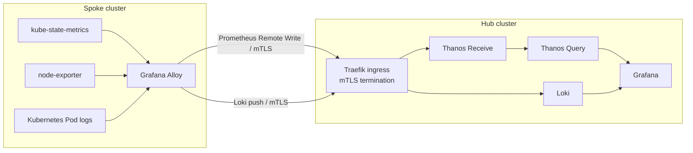

# Kubara Hub-and-Spoke Centralized Observability PoC

## Purpose

This proof of concept evaluates a centralized observability model for Kubara hub-and-spoke clusters.

The current Kubara model deploys the full observability stack on every cluster. The PoC tests a different model:

- the **hub** owns the observability UI, query layer, and persistence;
- a **spoke** only runs lightweight collectors/exporters;
- metrics and logs are **pushed from the spoke to the hub**;
- the cross-cluster telemetry path is protected with **mTLS**;
- every telemetry stream carries stable cluster identity labels so users can filter by cluster in Grafana.

The PoC is intentionally isolated under `observability-poc/` and does not change Kubara or catalog source code.

## Result

The PoC successfully demonstrates the following end-to-end flows:

```text
spoke-1
  Alloy
   ├── metrics ──mTLS──> Traefik ──> Thanos Receive ──> Thanos Query ──> Grafana
   └── logs    ──mTLS──> Traefik ──> Loki ────────────────────────────> Grafana
```

The hub runs the central backends and Grafana. The spoke does not run its own Prometheus server, Grafana, Alertmanager, or Loki.

## Architecture



### Metrics path

Alloy discovers and scrapes metrics from `kube-state-metrics` and `node-exporter` on the spoke. It adds stable external labels and sends samples using Prometheus Remote Write to Thanos Receive on the hub.

The PoC uses these labels:

```text
cluster="spoke-1"
cluster_type="spoke"
stage="local"
```

Thanos Receive stores the data and exposes it through its StoreAPI. Thanos Query is configured against the receiver and is used as the Prometheus-compatible Grafana datasource.

### Logs path

Alloy uses Kubernetes discovery and `loki.source.kubernetes` to collect Pod logs through the Kubernetes API. The log pipeline adds the same cluster identity labels and pushes the streams to Loki on the hub.

Grafana queries Loki through the hub-internal ClusterIP service.

### Security boundary

The spoke-to-hub path uses mTLS.

The hub PKI is managed with cert-manager. A local CA issues:

- one server certificate for the hub telemetry ingress;
- one client certificate for `spoke-1`.

Traefik requires and verifies the client certificate before forwarding requests to Thanos Receive or Loki.

The client key is stored only in Kubernetes Secrets and is not committed to Git. For this PoC the client Secret is copied to the spoke manually. Production secret/certificate distribution is intentionally out of scope.

Grafana-to-Thanos and Grafana-to-Loki traffic remains cluster-local HTTP. The protected trust boundary in this PoC is the cross-cluster ingestion path.

## Components

| Location | Component | Purpose |
| --- | --- | --- |
| Hub | Grafana | Central UI for metrics and logs |
| Hub | Thanos Receive | Prometheus Remote Write ingestion |
| Hub | Thanos Query | Prometheus-compatible central query endpoint |
| Hub | Loki | Central log ingestion, storage, and query |
| Hub | Traefik | Exposes telemetry endpoints and enforces mTLS |
| Hub | cert-manager | Issues the PoC CA, server certificate, and spoke client certificate |
| Spoke | Grafana Alloy | Discovers, labels, collects, and pushes metrics and logs |
| Spoke | kube-state-metrics | Kubernetes object/state metrics |
| Spoke | node-exporter | Node/OS metrics |

Alloy runs as a single-replica Deployment in this PoC. The current metrics discovery is cluster-wide and the log source reads through the Kubernetes API, so running one replica avoids duplicate collection on multi-node spokes. If a future implementation switches to node-local file tailing, a DaemonSet would be more appropriate.

## Repository layout

```text
observability-poc/
├── argocd/
│   ├── project.yaml
│   ├── hub-pki.yaml
│   ├── hub-thanos.yaml
│   ├── hub-loki.yaml
│   ├── hub-grafana.yaml
│   ├── spoke-1-alloy.yaml
│   └── spoke-1-exporters.yaml
├── hub/
│   ├── pki/
│   ├── thanos/
│   ├── loki/
│   └── grafana/
└── spoke/
    ├── alloy/
    └── exporters/
```

The existing hub Grafana also needs the local PoC override:

```text
platform-configs/hub-cluster/helm/kube-prometheus-stack/values-observability-poc.yaml
```

That override keeps the Grafana root filesystem read-only, adds a writable `/tmp` for Grafana backend plugins, disables automatic updates of bundled plugins, and increases Grafana memory for the Grafana 13.2 plugin processes.

## Deployment sequence

The PoC was built in this order:

1. Bootstrap the Kubara hub and register/bootstrap `spoke-1`.
2. Create the isolated `observability-poc` Argo CD project.
3. Deploy the hub PKI resources and issue server/client certificates.
4. Copy the spoke client certificate Secret from the hub to the spoke for the PoC.
5. Deploy Thanos Receive and Thanos Query on the hub.
6. Deploy `kube-state-metrics` and `node-exporter` on the spoke.
7. Deploy Alloy on the spoke and verify metrics remote-write over mTLS.
8. Deploy Loki on the hub and enable Alloy log collection/push.
9. Provision Thanos and Loki as Grafana datasources through the Grafana datasource sidecar.
10. Apply the Grafana compatibility override required by the current Grafana 13.2/chart combination.
11. Verify mTLS enforcement and query spoke metrics/logs in Grafana.

See `docs/setup.md` for the reproducible high-level setup and validation flow.

## Verification

The following queries were used for the final Grafana validation.

Metrics through the **Thanos** datasource:

```promql
kube_node_info{cluster="spoke-1",cluster_type="spoke",stage="local"}
```

```promql
node_cpu_seconds_total{cluster="spoke-1",cluster_type="spoke",stage="local"}
```

Logs through the **Loki** datasource:

```logql
{cluster="spoke-1",cluster_type="spoke",stage="local"}
```

mTLS was also tested directly:

- a request without a client certificate is rejected during TLS negotiation;
- a request with the spoke client certificate reaches the backend endpoint.

## PoC-specific choices and production gaps

This repository demonstrates the architecture, not a production-ready observability platform.

The following choices are intentionally local/PoC-only:

- local KIND networking and `*.172.18.0.2.traefik.me` hostnames;
- a local Traefik NodePort for cross-cluster telemetry;
- manual client-certificate Secret distribution;
- a single Thanos Receive replica with local PVC storage;
- a single-binary Loki deployment with local filesystem/PVC storage;
- no object storage, HA, multi-tenancy, quotas, or disaster-recovery design;
- no centralized alerting design in this PoC;
- no traces or OpenTelemetry application instrumentation;
- fixed `spoke-1`, `hub-cluster`, and `stage=local` values rather than generated cluster metadata.

For production, stable DNS, automated workload identity/certificate distribution, object storage, HA, retention/tenancy policies, capacity planning, and a supported upgrade strategy are required.

## Tooling evaluation

The PoC chose **Grafana Alloy + Thanos + Loki** because it provides a small spoke footprint, Prometheus-compatible metrics ingestion/querying, and native Loki log forwarding while keeping the central backends on the hub.

A comparison of Prometheus, Thanos, Grafana Mimir, VictoriaMetrics, Alloy, and OpenTelemetry Collector is available in `docs/tooling-evaluation.md`.
